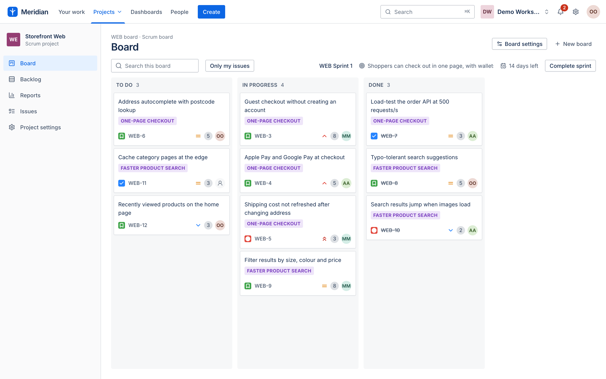
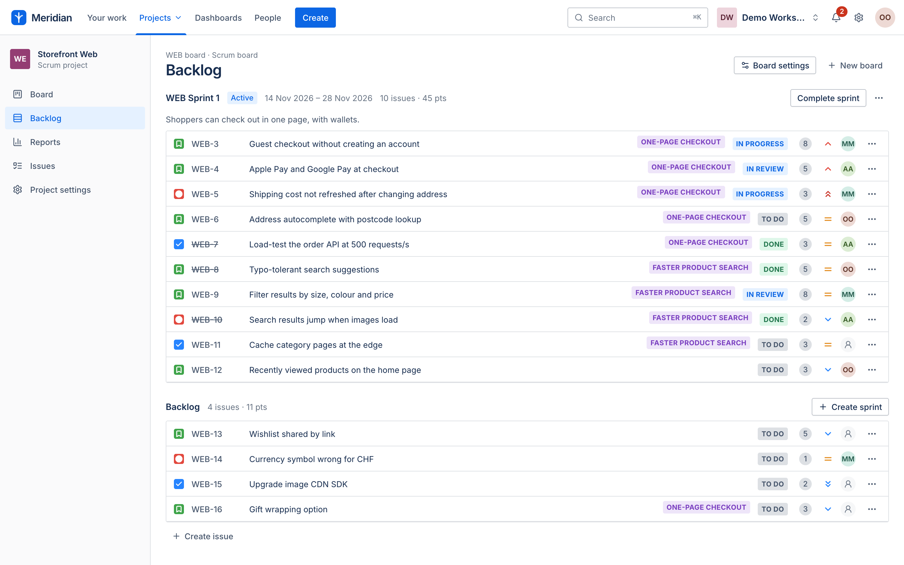
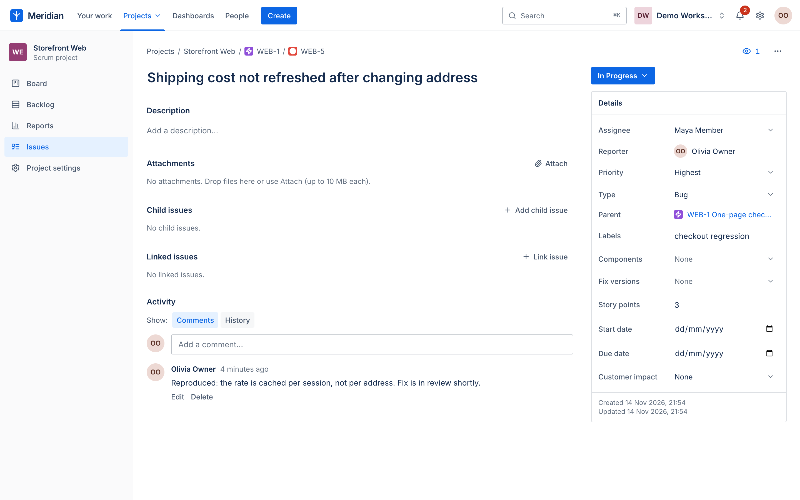
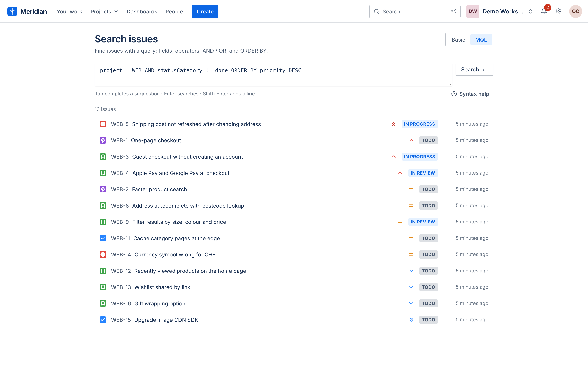
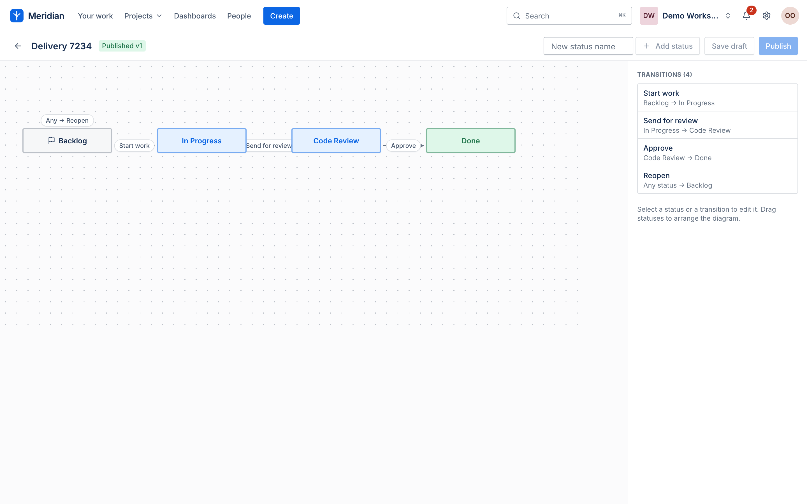
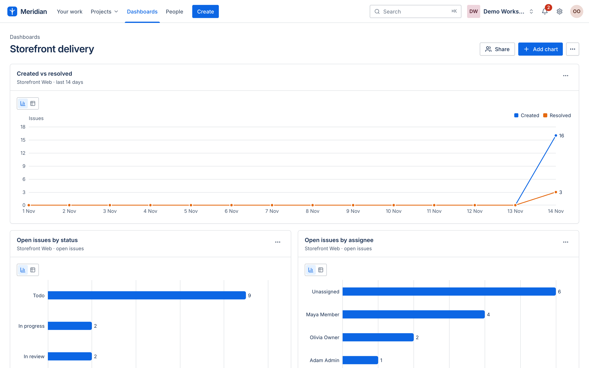
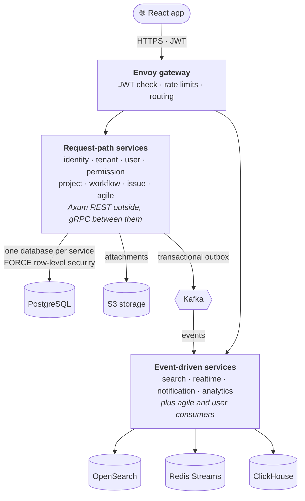
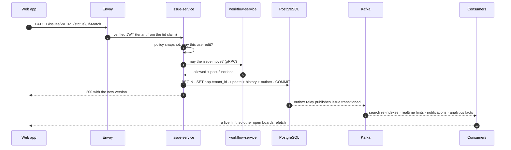

<div align="center">


# Meridian

**A multi-tenant project tracker in the style of Jira, built from scratch.**<br>
Twelve Rust microservices, a React + TypeScript app, and an event-driven core:<br>
boards, sprints, workflows, search, live updates and dashboards, all working end to end.

[](https://github.com/IshaanNene/Jira/actions/workflows/ci.yml)


[**Features**](#features) ·
[**Screenshots**](#a-look-around) ·
[**Architecture**](#architecture) ·
[**Quick start**](#quick-start) ·
[**Security**](#security-model) ·
[**Performance**](#measured-not-claimed) ·
[**Docs**](#documentation)

<br>

<picture>
  <source media="(prefers-color-scheme: dark)" srcset="docs/images/board-dark.png">
  
</picture>

<sub>The sprint board, in the theme your GitHub uses. Every screenshot here is of the real app running on Kubernetes (kind).</sub>

</div>

---

## Why this exists

Most clones stop at the UI. Meridian's goal is the whole system behind one, built with production
constraints from the first commit:

- **Real multi-tenancy.** The tenant comes only from a signed token, and PostgreSQL row-level security
  enforces it underneath the application code.
- **Real events.** Every write lands in a transactional outbox, flows through Kafka, and feeds
  search, notifications, live updates and analytics.
- **Real operations.** Distroless images, a Helm chart, Terraform for AWS, CI with vulnerability scans,
  Prometheus alerts, and load and failure tests.
- **An honest ledger.** [`docs/IMPLEMENTATION_ROADMAP.md`](docs/IMPLEMENTATION_ROADMAP.md) records what works,
  how it was verified, and what is still missing. Nothing in this README is aspirational.

> [!NOTE]
> Meridian follows Jira's layout conventions but uses its own name, logo and Lucide icons, with no
> Atlassian assets. The product name is configuration (`PRODUCT_NAME`, `VITE_PRODUCT_NAME`).

## Features

<table>
<tr>
<td width="50%" valign="top">

### 📋 Issues
Seven issue types with epics, child issues and subtasks. Issues also have:
- Comments, links, watchers and full history.
- Rich-text descriptions.
- Attachments, with the file type checked from the content and dangerous types refused.
- Admin-defined custom fields of 8 types, validated on every write.

Issue keys are gap-free even under concurrent creation.

</td>
<td width="50%" valign="top">

### 🏃 Boards and sprints
Scrum and Kanban boards with columns mapped to workflow statuses and WIP limits. Also:
- Ranking by drag and drop.
- Sprint planning, start and complete.
- Burndown and velocity reports.

Dropping a card asks the workflow engine first.

</td>
</tr>
<tr>
<td valign="top">

### 🔀 Workflow engine
A visual designer with draggable statuses and immutable published versions. Conditions, validators
and post-functions come from closed sets, so no user code ever runs. A workflow can be assigned per
project and per issue type.

</td>
<td valign="top">

### 🔎 Search and MQL
Full-text search on OpenSearch that tolerates typos and highlights matches. **MQL** is a query
language with fields, operators, `AND` / `OR` / `NOT`, relative dates and `ORDER BY`. It is compiled
on the server inside the tenant and visibility filters.

</td>
</tr>
<tr>
<td valign="top">

### ⚡ Live updates and notifications
Server-sent change hints over a Redis Streams buffer that resumes from a cursor. In-app and email
notifications respect each person's preferences, with signed one-click unsubscribe links.

</td>
<td valign="top">

### 📊 Dashboards
A ClickHouse pipeline fed from Kafka. Four chart kinds:
- Created vs resolved.
- Cycle time.
- Breakdowns of open issues.
- Velocity.

Charts can be shared, resized and reordered, and each one has a table view.

</td>
</tr>
<tr>
<td valign="top">

### 🔐 Identity and access
- Accounts with lockout and two-step verification (TOTP plus recovery codes), and passkeys.
- Single sign-on per workspace with OpenID Connect or SAML 2.0, and SCIM provisioning.
- Refresh-token rotation with reuse detection, and session management.
- Organisation roles and per-project role bindings, checked against local policy snapshots.

</td>
<td valign="top">

### 🧾 Audit log
Admin-relevant events go into an append-only log with a SHA-256 hash chain per tenant. An integrity
check names the first broken entry. The log exports to CSV with cells protected against spreadsheet
formulas.

</td>
</tr>
</table>

## A look around

<table>
<tr>
<td width="50%"><p align="center"><sub><b>Backlog</b>: an active sprint and the ranked backlog below it</sub></p></td>
<td width="50%"><p align="center"><sub><b>Issue view</b>: inline editing, an <code>If-Match</code> check against overwrites, history</sub></p></td>
</tr>
<tr>
<td><p align="center"><sub><b>MQL search</b>: a query compiled on the server, results ordered by priority</sub></p></td>
<td><p align="center"><sub><b>Workflow designer</b>: drag statuses, connect them, publish</sub></p></td>
</tr>
<tr>
<td colspan="2">
<picture>
  <source media="(prefers-color-scheme: dark)" srcset="docs/images/dashboard-dark.png">
  
</picture>
<p align="center"><sub><b>Dashboards</b>: charts from ClickHouse, limited to the projects you can browse</sub></p>
</td>
</tr>
</table>

## Architecture



<details>
<summary><b>How a status change flows through the system</b></summary>



</details>

### Design decisions

| Decision | Why | Record |
|---|---|---|
| Services are library crates, each with its own binary | Fast in-process integration tests and one shared release build | [ADR-0001](docs/adrs/0001-rust-microservices-as-library-crates.md) |
| Hybrid tenancy with RLS everywhere | One isolation rule whether a tenant has a shared or a dedicated database | [ADR-0002](docs/adrs/0002-hybrid-tenancy-with-rls-everywhere.md) |
| Short-lived EdDSA JWTs plus rotating refresh tokens | Verified at the edge and in every service; revoked through Redis | [ADR-0003](docs/adrs/0003-token-model.md) |
| A transactional outbox from day one | No lost or phantom events, and ordering per aggregate | [ADR-0004](docs/adrs/0004-outbox-from-day-one.md) |
| Authorisation snapshots with version checks | Local decisions; a grant or revoke takes effect on the next request | [ADR-0007](docs/adrs/0007-authorization-snapshots.md) |
| A Redis Streams buffer for live updates | Clients resume after a reconnect, and a detected gap forces a resync | [ADR-0008](docs/adrs/0008-realtime-redis-streams-buffer.md) |

All nine records are in [`docs/adrs`](docs/adrs).

## Tech stack

| Layer | Technology |
|---|---|
| **Services** | Rust (stable), Tokio, Axum, Tonic (gRPC), SQLx, rdkafka, utoipa (OpenAPI) |
| **Web** | React 18, TypeScript 5, Vite, TanStack Query, Radix UI, Tailwind, Tiptap, dnd-kit, ECharts |
| **Data** | PostgreSQL (one database per service, forced RLS), Redis, OpenSearch, ClickHouse, S3-compatible storage |
| **Messaging** | Kafka with a transactional outbox, inbox de-duplication and dead-letter topics |
| **Edge** | Envoy: edge JWT validation, request ids, rate limits |
| **Delivery** | Distroless images, Helm, Terraform (AWS: VPC, EKS, RDS, MSK, ElastiCache, OpenSearch, S3), GitHub Actions |
| **Operations** | OpenTelemetry → Jaeger, Prometheus with 7 alert rules, Grafana, k6 load tests, failure tests |

## Quick start

> [!TIP]
> You need Docker (with Compose), Rust stable, Node 22+, pnpm 10+, `protoc`, `cmake`, `pkg-config`, OpenSSL 3,
> libxml2 and xmlsec1 (SAML signatures). On macOS: `brew install protobuf cmake pkg-config openssl@3 libxmlsec1 libxslt`
> (the Makefile points the build at them); on Debian/Ubuntu: `apt install protobuf-compiler cmake pkg-config
> libssl-dev libclang-dev libxml2-dev libxmlsec1-dev libcurl4-openssl-dev`. Keep the checkout
> **outside** iCloud-synced folders such as the Desktop, because evicted files make local logs and caches hang.

```bash
make web-install   # once
```

```bash
make dev           # data stores, migrations, all twelve services, the web app
```

```bash
make seed          # optional: a demo workspace with accounts, a project and issues
```

Open **http://localhost:5173**. Signed out, it shows the public site (landing, features, pricing and security
pages) for demonstrating the product as a hosted service; **Sign in** takes you to the app. The seed script prints the
demo sign-ins: owner, admin, member and guest.
`make stop` stops the host processes. `make clean` also removes containers, volumes and build output.

<details>
<summary><b>All <code>make</code> targets</b></summary>

| Command | What it does |
|---|---|
| `make dev` / `make stop` | Start or stop everything |
| `make test` | Rust unit and integration tests (real PostgreSQL, Kafka, OpenSearch, ClickHouse) and web tests |
| `make lint` | rustfmt, clippy with warnings as errors, eslint, tsc |
| `make migrate` | Apply every service's migrations |
| `make gen-api` | Regenerate TypeScript types from the services' OpenAPI documents |
| `make logs` | Tail the service logs (`.run/logs/`) |
| `make observability` | Prometheus (:59090), Grafana (:53000) and Jaeger (:56686) |
| `make resilience` | Stop each data store under the running stack and check the documented behaviour |
| `make load` | k6 load test against the running stack (`tests/load/stress.mjs` finds saturation with autocannon) |
| `make images` | Build all 13 container images |
| `make kind-up` / `make kind-down` | Run the Helm chart in a local three-node kind cluster (:8088) |

</details>

<details>
<summary><b>What runs where locally</b></summary>

| Piece | Address | Role |
|---|---|---|
| Web app (Vite) | http://localhost:5173 | Proxies `/api` to the gateway |
| Gateway (Envoy) | http://localhost:8080 | Edge JWT check, rate limits, routing |
| identity · tenant · user | :8101 · :8102 · :8103 | Accounts and tokens · tenant registry · organisations and members |
| project · issue · workflow | :8104 · :8105 · :8106 | Projects · issues · workflow engine |
| agile · permission | :8107 · :8108 | Boards and sprints · role bindings |
| realtime · notification | :8109 · :8110 | Live updates · in-app and email notifications |
| search · analytics | :8111 · :8113 | OpenSearch indexing and MQL · ClickHouse charts |
| PostgreSQL / Redis | :54320 / :63790 | Non-default ports, to avoid clashing with local installs |
| Object storage (SeaweedFS) | :58333 | Attachments (S3 API) |
| Mailpit | :58025 | Catches outgoing email |

Every service exposes `/health/live`, `/health/ready`, `/metrics` and `/openapi.json`.
Configuration is environment variables only; `.env.example` documents every one and contains only
development placeholders.

</details>

## Security model

> [!IMPORTANT]
> **The tenant comes from the signed token and from nowhere else.** No path, query string, header
> or request body can choose the tenant.

- **Defence in depth for tenancy.** Each request runs in a transaction that sets `app.tenant_id`.
  Every tenant-owned table has `FORCE ROW LEVEL SECURITY`, and the runtime database role cannot bypass it.
  Tests prove that the API, and the database itself, never cross tenants.
- **No user code executes.** Workflow conditions, validators and post-functions, and analytics
  queries, are built from closed sets with typed parameters.
- **Uploads are validated by content.** Object keys are generated by the server with a tenant
  prefix. Downloads are authorised, proxied and always served as attachments.
- **Secrets stay secret.** Nothing is hardcoded. Signing keys and TOTP secrets are sealed with AES-256-GCM.
  Credentials never appear in logs or in `Debug` output.
- **Tamper-evident audit.** The log is append-only, enforced by a trigger and revoked grants, and each
  tenant's entries form a hash chain.

The full threat model is in [`docs/SECURITY_DESIGN.md`](docs/SECURITY_DESIGN.md).

## Quality

| Check | Result |
|---|---|
| 🧪 **Tests** | **208 Rust** (unit and integration against real data stores, each test in its own database) and **94 web** tests |
| 🧹 **Static checks** | `clippy -D warnings`, `rustfmt`, eslint, tsc, `cargo-deny` advisories, actionlint |
| 🐳 **Images** | 13 distroless and unprivileged images, each started once during the build; all pass Trivy with no fixable high or critical issues |
| ⎈ **Chart** | `helm lint`; the generated Envoy configuration passes `envoy --mode validate`; installed and used on a three-node kind cluster |
| 💥 **Failure tests** | Kafka, OpenSearch, ClickHouse, Redis and PostgreSQL stopped in turn under the running stack: **21 of 21 checks pass** |

## Measured, not claimed

An [autocannon](https://github.com/mcollina/autocannon) stress test ([`tests/load/stress.mjs`](tests/load/stress.mjs)):
- **Setup:** release builds on a three-node kind cluster, one replica per service, everything on **one laptop**
  (Apple M4 Pro).
- **Route:** all requests go through the Envoy gateway, with its rate limit raised for the test.
- **Mix:** reads use the same mix as the k6 test: issue lists, issues, boards, unread counts, search and charts.

| Load | Served | p50 | p99 | Failed |
|---|---|---|---|---|
| Reads at 500/s | 500/s | 4 ms | 37 ms | 0 |
| Reads at 1,000/s | 1,000/s | 7 ms | 70 ms | 0 |
| Reads at 2,000/s | 1,948/s | 16 ms | 249 ms | 8 of 58,447 |
| Reads, no rate cap | **2,959/s** | 58 ms | 178 ms | 96 of 88,829 |
| Writes at 200/s | 200/s | 6 ms | 24 ms | 0 |
| Writes, no rate cap | **1,799/s** | 102 ms | 310 ms | **0 of 35,967** |

> [!NOTE]
> The services were not the first thing to saturate; the query engines were. Alone, the Postgres-backed
> endpoints peak at **4,400–7,000 reads/s**, search (OpenSearch) at 1,900/s and chart queries (ClickHouse)
> at 670/s. With the production limit, the gateway serves 200 requests/s per pod and answers the excess with
> `429` and `retry-after`. After the uncapped write burst, Kafka delivered all ~40,000 events to search and
> analytics, and none were lost.

These are single-machine numbers, where the load generator and every data store share 14 cores. They are not
a capacity claim. The full results, including what the test found, are in the
[roadmap](docs/IMPLEMENTATION_ROADMAP.md#measured-performance).

## Project status

| Phase | Scope | |
|---|---|:-:|
| 0 | Architecture, contracts, ADRs | ✅ |
| 1 | Identity, tenants, organisations, gateway, web shell | ✅ |
| 2 | Projects, issues, permissions | ✅ |
| 3 | Workflow engine and visual designer | ✅ |
| 4 | Boards, backlog, sprints, reports | ✅ |
| 5 | Kafka pipeline, search, live updates, notifications | ✅ |
| 6 | MQL, audit log, two-step verification, passkeys, SSO (OIDC and SAML), SCIM users, admin console, automation rules and webhooks done; SCIM groups and integrations still to do | 🚧 |
| 7 | ClickHouse pipeline and dashboards | ✅ |
| 8 | Images, Helm, CI, observability, load and failure tests done; Terraform never applied, no Argo CD | 🚧 |

✅ means built and verified; 🚧 means partly built. Every phase has a "gaps" table in the
[roadmap](docs/IMPLEMENTATION_ROADMAP.md) listing exactly what is missing.

## Repository layout

```
apps/web/          React app: one module per feature, design system in src/components/ui
services/          12 services, one crate each: src/, migrations/, tests/, README.md
crates/            shared infrastructure: errors, auth, tenant routing, events, telemetry
proto/             internal gRPC contracts
infrastructure/    Dockerfiles, Envoy, Postgres bootstrap, Helm chart, Terraform, observability
scripts/           development, seed, images, kind
tests/             load (k6) and failure tests
docs/              design documents, ADRs, screenshots
```

## Documentation

| Document | What it covers |
|---|---|
| 🏛️ [Architecture](docs/ARCHITECTURE.md) | Services, boundaries and the brief's phase order |
| 🧭 [System design](docs/SYSTEM_DESIGN.md) | Scaling, caching, reliability, with results from the failure tests |
| 🗄️ [Database design](docs/DATABASE_DESIGN.md) | Schemas, RLS and the outbox |
| 🔌 [API specification](docs/API_SPECIFICATION.md) | REST conventions, errors, pagination, concurrency control |
| 📨 [Event architecture](docs/EVENT_ARCHITECTURE.md) | Envelope, topics, delivery guarantees |
| 🛡️ [Security design](docs/SECURITY_DESIGN.md) | Threat model and controls |
| 🚀 [Deployment guide](docs/DEPLOYMENT_GUIDE.md) | Images, Helm, kind, Terraform, CI |
| 🗺️ [Roadmap and status](docs/IMPLEMENTATION_ROADMAP.md) | The honest ledger |
| 🤝 [Contributing](CONTRIBUTING.md) | The rules enforced in review |

<div align="center">
<br>
<sub>Built in Rust and TypeScript, one vertical slice at a time.</sub>
</div>
