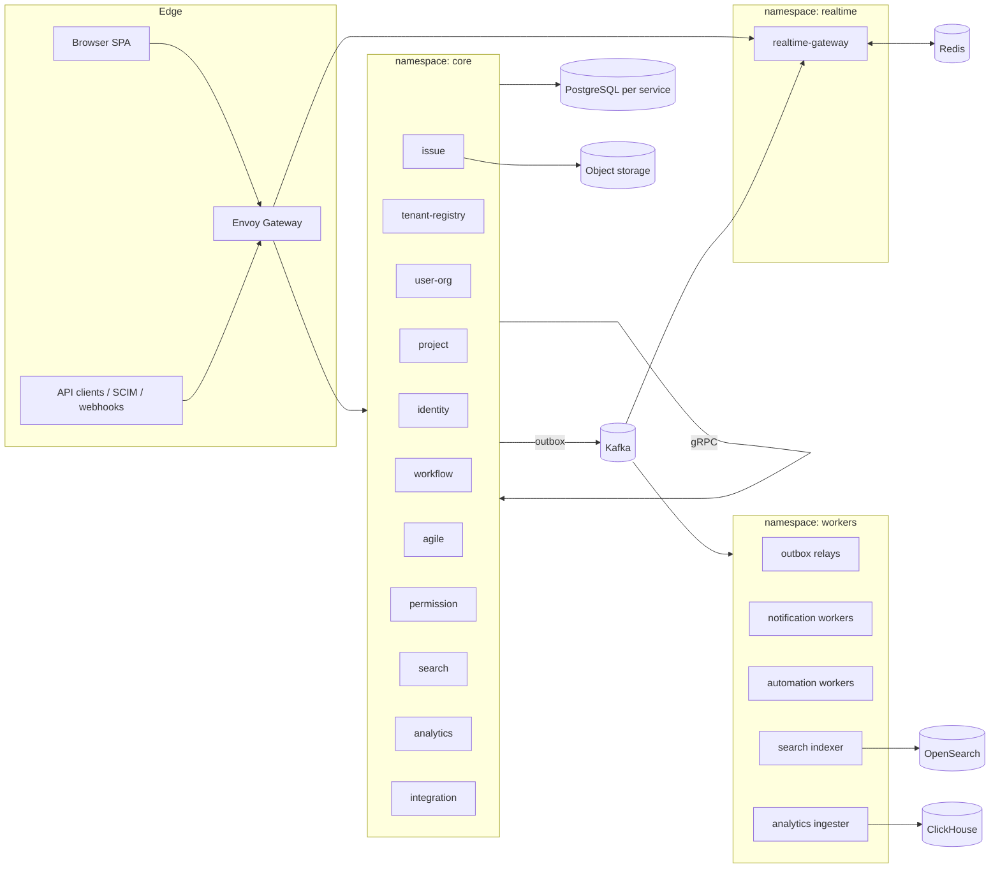

# Architecture

Status: living document. Updated at the end of every phase. The current implementation state is tracked in
[IMPLEMENTATION_ROADMAP.md](IMPLEMENTATION_ROADMAP.md) — this file describes the *target*, and says so where the
target is not yet built.

The product name is a placeholder. It is read from `PRODUCT_NAME` (services) and `VITE_PRODUCT_NAME` (web) and
defaults to **Meridian**. Nothing in code, schemas or infrastructure names depends on it.

## 1. Shape of the system



Three kinds of traffic, each with one transport:

| Need | Transport | Rule |
|---|---|---|
| Public API | REST/JSON over HTTPS, `/api/v1/...` | Only through the gateway. Versioned in the path. |
| Internal, answer needed now | gRPC (tonic), mTLS + service token | Deadline on every call, bounded retry, circuit breaker. |
| Internal, answer not needed now | Kafka via transactional outbox | Consumers are idempotent. No cross-service transactions. |

## 2. Service responsibility matrix

Ports are local-development defaults (`HTTP / gRPC`).

| # | Service | Owns (source of truth) | Sync deps (gRPC out) | Publishes | Consumes | Ports |
|---|---|---|---|---|---|---|
| 1 | API gateway (Envoy) | nothing | — | — | — | 8080 |
| 2 | identity-service | credentials, sessions, MFA, IdP config, API tokens, signing keys, login history | user-org (membership check on token exchange) | `identity.*` | `membership.changed`, `user.suspended` | 8101 / 9101 |
| 3 | tenant-service | tenant registry, placement, tier, provisioning state | — | `tenant.*` | — | 8102 / 9102 |
| 4 | user-service | profiles, organizations, memberships, teams, groups, invitations, SCIM, org settings | tenant-registry (provision, resolve) | `organization.*`, `membership.*`, `user.*`, `team.*` | `identity.user_registered` | 8103 / 9103 |
| 5 | project-service | projects, components, versions, releases, templates, project config | permission | `project.*` | `organization.deleted` | 8104 / 9104 |
| 6 | issue-service | issues, keys, custom field defs + values, comments, attachment metadata, links, history | permission, workflow (transition validation), project (config snapshot, cached) | `issue.*`, `comment.*` | `project.*`, `workflow.updated` | 8105 / 9105 |
| 7 | workflow-service | workflow definitions, versions, schemes | — | `workflow.*` | — | 8106 / 9106 |
| 8 | agile-service | boards, columns, ranks, sprints, sprint membership | permission, issue (read) | `sprint.*`, `board.*` | `issue.*` | 8107 / 9107 |
| 9 | permission-service | roles, schemes, grants, groups→role bindings, issue security levels, policy versions | — | `permission.updated` | `membership.changed`, `project.created` | 8108 / 9108 |
| 10 | search-service | saved filters, search history (PG); issue index (OpenSearch, derived) | permission | — | `issue.*`, `comment.*`, `project.*` | 8109 / 9109 |
| 11 | notification-service | preferences, schemes, in-app notifications, delivery log | — | `notification.delivered` | nearly everything | 8110 / 9110 |
| 12 | automation-service | rules, rule versions, execution history | issue, agile (actions, via gRPC) | `automation.*` | trigger topics | 8111 / 9111 |
| 13 | integration-service | connections, encrypted secrets, webhook subscriptions, delivery log, dev-activity links | — | `integration.*` | `issue.*`, `sprint.*` | 8112 / 9112 |
| 14 | analytics-service | dashboards + widget config (PG); facts (ClickHouse, derived) | permission | — | `issue.*`, `sprint.*` | 8113 / 9113 |
| 15 | realtime-service | nothing durable; Redis for presence/fanout/replay buffer | identity (JWKS only) | — | client-visible topics | 8114 / — |

Audit is a cross-cutting concern: every service emits `audit.recorded` through its outbox; the audit store
(hash-chained, append-only) is owned by **user-service** in Phase 6 because org administrators are its readers.
If audit volume justifies it, it becomes its own deployment unit without a contract change (ADR-0009).

### Deployment units vs. logical services

Fifteen logical services do not mean fifteen always-on deployments on day one. Each service is a library crate
(`router()`, `grpc()`, `workers()`) plus a thin `main.rs`. That gives three packaging options without touching
business code:

1. **One process per service** — production default.
2. **Split API and workers** of the same service into different Deployments (`--role api|worker`) so Kafka
   consumers scale on lag (KEDA) independently of HTTP traffic. Used for notification, automation, search, analytics.
3. **Co-located small tenants / dev**: not built. If it is ever needed it is a new `main.rs`, not a redesign.

## 3. Dependency rules

- The synchronous call graph is a DAG, depth ≤ 2 from the gateway. `permission`, `workflow` and `tenant-registry`
  are leaves: they call nobody.
- No service reads another service's tables. Ever. Shared PostgreSQL *clusters* are fine; shared *schemas* are not.
- A service that needs another's data on a hot path keeps a **local read model** fed by events (e.g. issue-service
  keeps project key + issue-type config; agile-service keeps the issue fields it needs for cards) instead of calling
  per request.
- Authorization is enforced in every service, using a locally cached, versioned policy snapshot
  (see [SECURITY_DESIGN.md](SECURITY_DESIGN.md) §4). It never becomes a per-row remote call.

## 4. Shared crates

Only infrastructure and contracts — no business rules.

| Crate | Contents |
|---|---|
| `platform-common` | config loading, ids, pagination, time, service bootstrap + graceful shutdown |
| `error-handling` | `ApiError` → RFC 9457 problem+json, gRPC status mapping, error codes |
| `auth-middleware` | JWT verification (JWKS cache), `AuthContext` extractor, service-to-service tokens, permission-check trait |
| `tenant-context` | `TenantId`, tenant-scoped transaction (`SET LOCAL app.tenant_id`), database router |
| `event-contracts` | event envelope, typed payloads, topic names, outbox writer + relay |
| `api-contracts` | generated tonic code from `proto/` |
| `observability` | tracing/OTel setup, JSON logs, Prometheus metrics layer, request-id propagation |
| `test-utilities` | ephemeral database per test, token minting, fixtures |

## 5. Frontend architecture

`apps/web` — React 18, strict TypeScript, Vite, Tailwind.

- **Module boundaries**: `src/modules/<feature>/{api,components,pages,hooks}`. A module may import from
  `src/components` (design system), `src/services`, `src/state`, `src/utils` — never from another module's internals.
  Cross-module use goes through the module's `index.ts`.
- **State**: TanStack Query owns everything that came from the server. Zustand owns only client state: session
  (in-memory access token, active organization), UI chrome (sidebar, command palette, theme), and draft state
  that has not been sent. A server entity is never copied into Zustand.
- **API client** (`src/services/api`): one `fetch` wrapper that attaches the access token, performs single-flight
  refresh on 401, propagates `x-request-id`, and turns problem+json into a typed `ApiError`. Types come from the
  OpenAPI documents each service serves (`pnpm gen:api`).
- **Realtime** (`src/realtime`): one WebSocket per tab, topic subscriptions with cursors; incoming events
  invalidate or patch TanStack Query caches. SSE is used per long-running job.
- **Design system** (`src/components/ui`): Radix primitives + Tailwind tokens (CSS variables, light/dark),
  documented in Storybook.
- Routes are lazy-loaded; every route has an error boundary, a skeleton and an empty state.

## 6. Repository structure

```
apps/web/                 React SPA
services/<name>-service/  one crate per logical service (src/, migrations/, tests/, Dockerfile, README.md)
crates/                   shared infrastructure crates (table above)
proto/                    protobuf contracts, one package per service
infrastructure/           docker/, docker-compose/, envoy/, helm/, kubernetes/, terraform/, monitoring/, postgres/
scripts/                  development/, migrations/, seed/, load-testing/
docs/                     this directory; adrs/ holds decision records
```

## 7. Known inconsistencies in the brief, and how they were resolved

| Tension | Resolution |
|---|---|
| "15 microservices" vs "only add deployment units with operational reason" | Library-per-service; deployment granularity is a packaging decision (§2). |
| Permission service scheduled in Phase 6, but "never postpone authorization" | Authorization is enforced from Phase 1 using org roles carried in signed tokens. The permission-service **core** (roles, schemes, check API, versioned cache) moves to Phase 2 because projects need project roles. Phase 6 adds issue security, field-level rules, access reviews. |
| Kafka arrives in Phase 5, but issue creation "must include outbox → Kafka" | The outbox table and writer exist from Phase 1 so every write is already event-producing. The relay to Kafka is switched on in Phase 5; until then events accumulate and are replayed. A vertical slice is not called complete in the roadmap until its consumers exist. |
| Envoy Gateway "enforces authentication" vs "every service enforces authorization" | Gateway does coarse JWT validation and rate limiting. Services re-verify the token signature themselves. The gateway is never the only check. |
| Tenant registry maps tenant ↔ organization, both ids exist | 1:1 today. `tenant_id` is the isolation/routing key; `organization_id` is the product-facing id. Kept distinct so one tenant could later host several organizations (enterprise sub-orgs) without a data migration. |
| automation-service (rules, Kafka triggers, actions over gRPC) vs "only add deployment units with operational reason" | Automation runs **inside issue-service**. Rules triggered by a change (creation, status change) run in that change's transaction: effects are atomic with it, the person sees them in the same response, and no write gRPC API is needed. Scheduled rules are drained by a runner in the same process (like the outbox relay), one issue per transaction. Rules may move issues and comment, but changes made by rules never trigger rules, so there is no loop to detect and no causation-depth header is needed. Nothing new is deployed. A separate automation-service consuming events becomes worth it with cross-project rules, triggers from other services, or slow actions (webhooks, email); the rule model is plain data and moves with it. |
| Global users vs tenant-scoped data | A person has one global identity and many memberships. Identity data is not tenant-owned; everything else is. |

Risks, bottlenecks and trade-offs are in [SYSTEM_DESIGN.md](SYSTEM_DESIGN.md) §9.
