# Database design

PostgreSQL is the source of truth. OpenSearch and ClickHouse are derived and rebuildable.
Tenancy mechanics (RLS, routing, tiers) are in [SYSTEM_DESIGN.md](SYSTEM_DESIGN.md) §2.

## 1. Ownership matrix

One database per service (`<service>_db`), even when they share a cluster. Each service has two roles:
`<service>_owner` (runs migrations, owns tables) and `<service>_app` (runtime; no DDL, no `BYPASSRLS`).

| Service | Store | Database | Tenant-owned? | Notes |
|---|---|---|---|---|
| identity | PostgreSQL | `identity_db` | No (global accounts) | sessions, credentials; IdP config rows carry `tenant_id` + RLS |
| tenant | PostgreSQL | `tenant_db` | No (it *is* the registry) | reachable only over gRPC from inside the mesh |
| user | PostgreSQL | `user_db` | Yes, except `user_profiles` and `user_org_directory` | |
| project | PostgreSQL | `project_db` | Yes | |
| issue | PostgreSQL | `issue_db` | Yes | largest; first candidate for partitioning by `tenant_id` hash |
| workflow | PostgreSQL | `workflow_db` | Yes | |
| agile | PostgreSQL | `agile_db` | Yes | |
| permission | PostgreSQL | `permission_db` | Yes | |
| notification | PostgreSQL | `notification_db` | Yes | `notifications` partitioned by month |
| automation | PostgreSQL | `automation_db` | Yes | `rule_executions` partitioned by month |
| integration | PostgreSQL | `integration_db` | Yes | secrets envelope-encrypted |
| search | OpenSearch + PostgreSQL `search_db` | Yes | PG holds saved filters/history only |
| analytics | ClickHouse + PostgreSQL `analytics_db` | Yes | PG holds dashboards/widgets only |
| realtime | Redis | — | key-prefixed | ephemeral |
| attachments | S3-compatible | bucket per region | key `t/{tenant_id}/{uuid}` | server-generated keys only |

## 2. Conventions

- Primary keys: `uuid` (UUIDv7 generated in the service).
- Every tenant-owned table: `tenant_id uuid NOT NULL`, FORCE RLS, composite indexes leading with `tenant_id`,
  uniqueness constraints scoped by `tenant_id`.
- Foreign keys exist **within** a service database only. References to another service's entity are plain
  `uuid` columns named `<entity>_id`; integrity is maintained by events.
- `created_at`, `updated_at timestamptz NOT NULL DEFAULT now()`; mutable aggregates carry `version bigint NOT NULL DEFAULT 1`.
- Soft delete (`deleted_at`) only where retention policy requires restore (projects, issues, comments).
- Every service database contains the same two infrastructure tables:

```sql
outbox(id uuid pk, tenant_id uuid, topic text, partition_key text, payload jsonb,
       created_at timestamptz, published_at timestamptz null, attempts int, last_error text)
       -- partial index on (created_at) where published_at is null
inbox(consumer text, event_id uuid, processed_at timestamptz, primary key (consumer, event_id))
```

- Migrations: `services/<svc>/migrations/NNNN_name.sql`, forward-only, run by `sqlx migrate` (`make migrate`).
  Destructive changes follow expand → migrate → contract across releases.

## 3. Entity model

```mermaid
erDiagram
  %% identity_db
  ACCOUNT ||--o{ SESSION : has
  ACCOUNT ||--o{ MFA_FACTOR : has
  ACCOUNT ||--o{ API_TOKEN : owns
  ACCOUNT ||--o{ LOGIN_EVENT : produces
  SESSION ||--o{ REFRESH_TOKEN : rotates

  %% tenant_db
  TENANT ||--o{ TENANT_MIGRATION : undergoes
  DATABASE_CLUSTER ||--o{ TENANT : hosts

  %% user_db
  ORGANIZATION ||--o{ MEMBERSHIP : has
  USER_PROFILE ||--o{ MEMBERSHIP : holds
  ORGANIZATION ||--o{ INVITATION : issues
  ORGANIZATION ||--o{ TEAM : has
  ORGANIZATION ||--o{ ORG_DOMAIN : verifies
  ORGANIZATION ||--o{ USER_GROUP : has
  TEAM ||--o{ TEAM_MEMBER : has
  TEAM ||--o| TEAM : parent
  USER_GROUP ||--o{ GROUP_MEMBER : has

  %% project_db
  PROJECT ||--o{ COMPONENT : has
  PROJECT ||--o{ VERSION : has
  PROJECT ||--o{ PROJECT_MEMBER : has
  PROJECT }o--|| PROJECT_CATEGORY : in
  PROJECT ||--o{ PROJECT_ISSUE_TYPE : enables

  %% issue_db
  ISSUE ||--o{ ISSUE : parent
  ISSUE ||--o{ COMMENT : has
  ISSUE ||--o{ ATTACHMENT : has
  ISSUE ||--o{ ISSUE_LINK : source
  ISSUE ||--o{ ISSUE_HISTORY : records
  ISSUE ||--o{ WATCHER : watched_by
  ISSUE ||--o{ WORKLOG : logs
  ISSUE }o--|| ISSUE_TYPE : typed
  CUSTOM_FIELD ||--o{ CUSTOM_FIELD_CONTEXT : applies
  LINK_TYPE ||--o{ ISSUE_LINK : classifies

  %% workflow_db
  WORKFLOW ||--o{ WORKFLOW_VERSION : versions
  WORKFLOW_SCHEME ||--o{ SCHEME_MAPPING : maps
  WORKFLOW ||--o{ SCHEME_MAPPING : used_by

  %% agile_db
  BOARD ||--o{ BOARD_COLUMN : has
  BOARD ||--o{ SPRINT : runs
  SPRINT ||--o{ SPRINT_ISSUE : contains
  BOARD ||--o{ ISSUE_RANK : orders

  %% permission_db
  ROLE ||--o{ ROLE_PERMISSION : grants
  PERMISSION_SCHEME ||--o{ SCHEME_GRANT : contains
  ROLE ||--o{ ROLE_BINDING : bound
```



Cross-database references (by id, no FK): `MEMBERSHIP.user_id → ACCOUNT`, `ORGANIZATION.tenant_id → TENANT`,
`PROJECT.organization_id`, `ISSUE.project_id / assignee_id / status_id / sprint via agile`, `ROLE_BINDING.subject_id`.

## 4. Key tables

### identity_db
| Table | Key columns |
|---|---|
| `accounts` | `id`, `email citext UNIQUE`, `password_hash` (Argon2id PHC), `email_verified_at`, `status` (active/suspended/locked), `failed_login_count`, `locked_until` |
| `sessions` | `id`, `account_id`, `created_at`, `last_seen_at`, `expires_at`, `revoked_at`, `ip inet`, `user_agent`, `device_label` |
| `refresh_tokens` | `id`, `session_id`, `token_hash bytea UNIQUE` (SHA-256), `family_id`, `used_at`, `expires_at` — reuse of a used token revokes the whole session |
| `signing_keys` | `kid`, `algorithm`, `public_jwk`, `private_key_enc`, `status` (active/retiring/retired) |
| `email_tokens` | verification + password reset; hashed, single-use, expiring |
| `totp_factors` | `account_id`, `secret_enc` + `nonce` (sealed), `confirmed_at` (NULL during set-up), `last_used_step`, `setup_attempts` |
| `recovery_codes` | `account_id`, `code_hash` (SHA-256), `used_at` |
| `mfa_challenges` | `account_id`, `token_hash`, `attempts`, `expires_at`, `used_at` — between password and code at sign-in |
| `passkeys`, `webauthn_challenges` | Built (Phase 6) |
| `identity_providers` (tenant-scoped, RLS) | OIDC/SAML config per organization — Phase 6 |
| `api_tokens` | `id`, `account_id`, `tenant_id`, `token_hash`, `scopes text[]`, `expires_at`, `last_used_at` |
| `login_events` | append-only login history, used for suspicious-login detection |

### tenant_db
| Table | Key columns |
|---|---|
| `tenants` | `tenant_id`, `organization_id UNIQUE`, `deployment_tier`, `database_cluster_id`, `database_destination`, `region`, `tenant_status`, `provisioning_status`, `configuration_version`, `plan jsonb` |
| `database_clusters` | `id`, `region`, `kind` (shared/dedicated), `capacity`, `status` |
| `tenant_migrations` | `id`, `tenant_id`, `from_destination`, `to_destination`, `state`, timestamps |

### user_db
| Table | Key columns |
|---|---|
| `user_profiles` (global) | `user_id` (= account id), `display_name`, `email`, `avatar_key`, `timezone`, `locale`, `preferences jsonb` |
| `user_org_directory` (global) | `(user_id, organization_id)`, `tenant_id` — answers "which organizations am I in" without crossing RLS |
| `organizations` | `id`, `tenant_id UNIQUE`, `name`, `slug UNIQUE`, `logo_key`, `settings jsonb`, `security_policy jsonb`, `version` |
| `memberships` | `(tenant_id, user_id)`, `org_role` (owner/admin/member/guest), `status` (active/suspended), `joined_at` |
| `invitations` | `id`, `email`, `org_role`, `token_hash`, `invited_by`, `expires_at`, `accepted_at`, `revoked_at` |
| `teams`, `team_members` | `parent_team_id`, `kind` (team/department), `lead_user_id`; member `role` (lead/member) |
| `org_domains`, `user_groups`, `group_members`, `audit_log` | Phase 6 (audit rows hash-chained: `prev_hash`, `hash`) |

### issue_db (Phase 2)
| Table | Key columns |
|---|---|
| `issues` | `id`, `tenant_id`, `project_id`, `number`, `key` (generated `PROJ-n`), `type_id`, `status_id`, `status_category`, `priority`, `summary`, `description jsonb` (TipTap doc), `assignee_id`, `reporter_id`, `creator_id`, `parent_id`, `labels text[]`, `component_ids uuid[]`, `fix_version_ids uuid[]`, `affects_version_ids uuid[]`, `start_date`, `due_date`, `resolution`, `resolved_at`, `story_points numeric`, `original_estimate_s`, `remaining_estimate_s`, `time_spent_s`, `environment`, `security_level_id`, `custom_fields jsonb`, `version`, `deleted_at`. `UNIQUE (tenant_id, project_id, number)` |
| `project_issue_counters` | `(tenant_id, project_id)`, `next_number` |
| `issue_types` | system + custom, `hierarchy_level` (epic 1 / standard 0 / subtask -1) |
| `custom_fields` | `id`, `key`, `name`, `field_type`, `config jsonb` (options, min/max, regex), `required` |
| `custom_field_contexts` | `field_id`, `project_id NULL`, `issue_type_id NULL` — applicability |
| `comments` | `body jsonb`, `author_id`, `edited_at`, `deleted_at`, `version` |
| `attachments` | metadata only: `object_key`, `filename`, `content_type`, `size`, `sha256`, `scan_status` |
| `link_types`, `issue_links` | `(source_id, target_id, link_type_id)` unique; inward/outward names |
| `issue_history` | append-only: `issue_id`, `actor_id`, `changes jsonb [{field, from, to}]`, `issue_version` |
| `watchers`, `votes`, `worklogs` | |

Custom-field values live in `issues.custom_fields` (`{ "<field_id>": value }`), validated against the field
definition in the service. Rationale and alternatives (EAV, table-per-field) in ADR-0005.

### analytics_db (Phase 7)
| Table | Key columns |
|---|---|
| `dashboards` | `tenant_id`, `id`, `name` (1–80), `description` (≤ 500), `owner_id`, `shared`, `created_at`, `updated_at`; forced RLS |
| `dashboard_widgets` | `tenant_id`, `id`, `dashboard_id` (cascade), `title`, `query jsonb` (validated widget query), `size` (`half`/`full`), `position`; forced RLS |

### ClickHouse `analytics` (Phase 7, derived)
| Table | Engine and key |
|---|---|
| `issue_events` | `ReplacingMergeTree(ingested_at)`, partitioned by month, `ORDER BY (tenant_id, event_type, event_id)`; event type, time, project, issue, sprint, actor, from/to status and category, sprint name and counts |
| `issue_state` | `ReplacingMergeTree(version, is_deleted)`, `ORDER BY (tenant_id, issue_id)`; key, type, status, category, priority, assignee, created / resolved / updated |

Both tables carry a row policy for the reader user: `tenant_id = toUUID(getSetting('SQL_tenant_id'))`. Users:
`analytics_owner` (migrations), `analytics_writer` (ingester: INSERT, SELECT), `analytics_reader` (API: SELECT,
`readonly = 2`, 10 s and 100 000-row limits).

Remaining service schemas are specified in the phase that builds them and appended here.

## 5. Indexing and growth

- `issues`: `(tenant_id, project_id, number)`, `(tenant_id, project_id, status_id)`,
  `(tenant_id, assignee_id) WHERE deleted_at IS NULL`, `(tenant_id, updated_at DESC)`, GIN on `labels`,
  GIN `jsonb_path_ops` on `custom_fields`.
- List endpoints use **keyset pagination** (`(sort_key, id) > ($1, $2)`), never `OFFSET` on large tables.
- Partitioning is introduced only when a table's measured size justifies it: first candidates are
  `issue_history`, `notifications`, `rule_executions`, `outbox` (time-range), then `issues` (hash by tenant).
- Read replicas: services accept a `DATABASE_READ_URL`; only explicitly replica-safe queries use it
  (lists, reports), never read-after-write paths.
- Sharding is a placement decision already expressible through the tenant registry (`database_destination`);
  no application change is required to add a second shared cluster.
